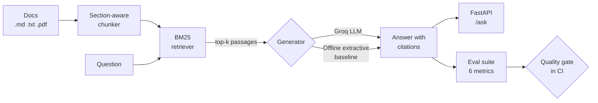

<div align="center">

# 🛡️ RAGGuard

**Retrieval-augmented QA that measures its own answer quality on every commit and blocks the merge when quality drops.**

[](https://github.com/Tejakumar02/RAGGuard/actions/workflows/ci.yml)


</div>

---

## Why this exists

Most RAG demos show that a chatbot *can* answer. Nobody can tell whether the next change to chunking, retrieval or the prompt made it **worse**. RAGGuard treats answer quality like a unit test:

- a **golden set** of 29 questions with expected sources and key facts, including 4 questions the documents cannot answer
- **six deterministic metrics** for retrieval, grounding, citations and abstention
- a **quality gate** in GitHub Actions that exits with code 1, and fails the pull request, when any metric falls below its threshold

## Architecture



| Component | Choice | Why |
|---|---|---|
| Chunking | Split on markdown headings, then pack whole sentences (~120 words, ~30-word overlap) | Chunks never cut a sentence in half, and every chunk keeps its section title |
| Retrieval | Okapi BM25 over title + text | No vector database or embedding API needed, fast and fully reproducible |
| Generation | Groq (`llama-3.3-70b-versatile`) with a strict cite-or-abstain prompt | Fast, free tier, temperature 0 |
| CI baseline | Deterministic extractive generator | The gate runs on every pull request with no API key and no flaky LLM output |

## Evaluation results

Offline extractive baseline on the bundled golden set (`python -m ragguard.eval.run`):

| Metric | What it checks | Score | Gate |
|---|---|---:|---:|
| Retrieval hit@4 | An expected document is in the top 4 passages | **1.000** | ≥ 0.95 |
| Retrieval MRR | How high the first correct passage ranks | **0.980** | ≥ 0.85 |
| Faithfulness | Answer sentences supported by the passages they cite | **0.920** | ≥ 0.90 |
| Citation validity | The answer cites at least one passage, and only passages that exist | **0.920** | ≥ 0.80 |
| Answer keyword recall | The key fact (e.g. "30 Nm") appears in the answer | **0.840** | ≥ 0.70 |
| Abstention accuracy | Says "I don't know" for out-of-scope questions | **1.000** | = 1.00 |

The report also lists every case scoring below 1.0. The baseline's misses are real limitations of word matching. For example, it can't connect the question word "padlock" to the document's "lock", or "frame rate" to "frames per second". Those are the cases an LLM generator or embedding retriever should fix, and the eval measures whether it does.

### The gate catches regressions

The test suite deliberately removes one document from the corpus and asserts that the gate fails. The measured effect:

| Metric | Baseline | One document missing |
|---|---:|---:|
| Retrieval hit@4 | 1.000 | 0.800 ❌ |
| Retrieval MRR | 0.980 | 0.780 ❌ |
| Faithfulness | 0.920 | 0.720 ❌ |
| Citation validity | 0.920 | 0.720 ❌ |
| Answer keyword recall | 0.840 | 0.680 ❌ |
| Abstention accuracy | 1.000 | 1.000 ✅ |

## Quick start

```bash
git clone https://github.com/Tejakumar02/RAGGuard.git
cd RAGGuard
python -m venv .venv && source .venv/bin/activate   # Windows: .venv\Scripts\activate
pip install -r requirements-dev.txt

pytest -q                                  # unit + integration tests
python -m ragguard.eval.run                # offline eval gate (no API key needed)
```

Use a real LLM:

```bash
cp .env.example .env                       # then set GROQ_API_KEY in .env
export GROQ_API_KEY=your_key_here
python -m ragguard.eval.run --llm groq
uvicorn ragguard.api:app --reload          # http://localhost:8000/docs
```

### Ask a question

```bash
curl -X POST localhost:8000/ask \
  -H "Content-Type: application/json" \
  -d '{"question": "What torque are drain plugs tightened to?"}'
```

Response from the offline generator:

```json
{
  "answer": "Drain plugs are tightened to 30 Nm. [1] A drop of blue medium-strength thread locker is applied to drain plug threads before installation. [2]",
  "llm": "extractive",
  "citations": [1, 2],
  "sources": [{"n": 1, "id": "torque_and_fastening.md#1", "source": "torque_and_fastening.md", "title": "Torque and Fastening Standards > Torque values", "score": 10.89, "text": "..."}]
}
```

### Docker

```bash
docker build -t ragguard .
docker run -p 8000:8000 -e GROQ_API_KEY=your_key_here ragguard
```

### Use your own documents

Put `.md`, `.txt` or `.pdf` files in a folder (PDF needs `pip install pymupdf`), then:

```bash
RAGGUARD_DOCS=path/to/folder uvicorn ragguard.api:app
```

To evaluate on your own data, write `eval/golden.jsonl` lines like:

```json
{"id": "q1", "question": "...", "expected_sources": ["file.md"], "keywords": ["key fact"]}
{"id": "q2", "question": "out-of-scope question", "answerable": false}
```

## CI pipeline

| Job | Runs on | Blocks merge? |
|---|---|:---:|
| Lint (`ruff`) + tests (`pytest`) on Python 3.11 and 3.12 | every push and PR | ✅ |
| **Eval gate**: offline baseline vs `eval/thresholds.toml`, report uploaded as an artifact and shown in the job summary | every push and PR | ✅ |
| Docker build + smoke test: start the container, call `/health` and `/ask` | every push and PR | ✅ |
| Groq eval: the same golden set with the real LLM | `main`, when the `GROQ_API_KEY` secret is set | informational |

## Project structure

```text
ragguard/
├── ingest.py        # load .md/.txt/.pdf, section-aware sentence chunking
├── retriever.py     # Okapi BM25
├── llm.py           # Groq generator + offline extractive baseline
├── pipeline.py      # retrieve -> generate -> parse citations
├── api.py           # FastAPI: POST /ask, GET /health
└── eval/
    ├── metrics.py   # hit@k, MRR, faithfulness, citations, keywords, abstention
    └── run.py       # golden-set runner + quality gate (exit 1 on regression)
data/docs/           # sample corpus (a fictional plant handbook)
eval/golden.jsonl    # 29 labelled questions
eval/thresholds.toml # minimum score per metric, per generator
tests/               # pytest suite, including a deliberate-regression test
```

## Limitations and next steps

- **Faithfulness is a word-overlap check.** It catches invented numbers and facts, but it is not a full entailment check. Next step: an optional LLM-as-judge metric, reported next to the deterministic one.
- **BM25 misses synonyms** ("padlock" vs "lock"). Next step: hybrid BM25 + embedding retrieval, measured against this same golden set.
- **Groq thresholds are a starting point.** Calibrate them after the first few `main` runs, then make that job blocking.
- **The golden set is small (29 cases)**, so one case moves a metric by about 4 points. Grow it as the corpus grows.

## Sample data

The documents in `data/docs/` describe a **fictional** plant ("Kestrel Motors Plant 4") and were written for this project. They are not real procedures.

## License

[MIT](LICENSE) © 2026 Teja Kumar G S
